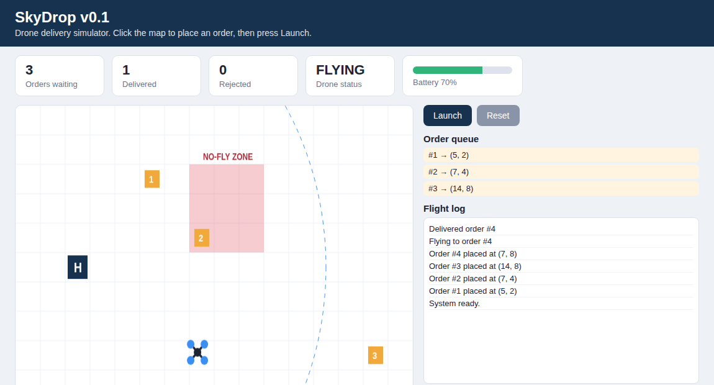

# SkyDrop

SkyDrop is a small drone delivery simulator used as a general software engineering case study. Students start with a buggy version 0.1 and grow it gradually through requirements, design, architecture, code review, testing, CI/CD, security, and maintenance activities.



## Run it

No install needed.

1. Download or clone this repository.
2. Open `app/skydrop.html` in Chrome, Edge, or Firefox (double-click it).
3. Click the map to place delivery orders, then press **Launch**.

The drone flies from the base (H) to each order and back to base to recharge. The red area is a no-fly zone. The dashed circle shows the safe flight range.

## Repository layout

```
app/                    The application (one HTML file for now)
docs/requirements.md    Current requirements, with IDs for traceability
docs/ROADMAP.md         Weekly labs and the research track
labs/                   One folder per activity with Markdown instructions
.github/ISSUE_TEMPLATE  Bug report template used in the labs
CHANGELOG.md            What changed in each version
CONTRIBUTING.md         How to branch, commit, and open a pull request
```

## Labs

| Lab | Topic | Folder |
|---|---|---|
| 1 | Debugging and bug reports | [labs/lab01-debugging](labs/lab01-debugging) |

More labs are added during the term. See [docs/ROADMAP.md](docs/ROADMAP.md).

## Version

Current version: **0.1** (contains known bugs on purpose; see Lab 1).

## License

MIT. See [LICENSE](LICENSE).
