# Lab 03: Feature Development and Unit Testing (Java)

**Time:** 30 minutes  **Tools:** VS Code, Java 17 or newer, JUnit 5  **Code:** [`skydrop-java/`](../../skydrop-java)

## Goal

By the end of this lab you will be able to:

1. run a Java GUI application from VS Code and test it by hand with chosen inputs;
2. explain what a unit test is and why it is faster and more reliable than clicking through the GUI;
3. read and run three JUnit test cases;
4. write one test case yourself; and
5. add a small feature (reject orders that are off the map) by writing the test **first**, watching it fail, and then making it pass.

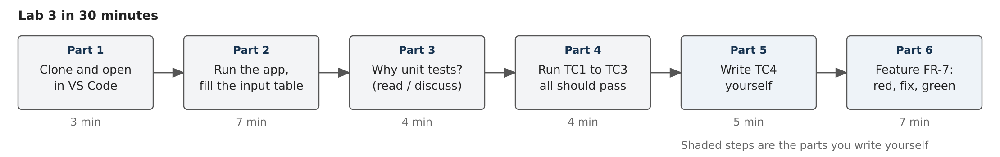

## Scenario

SkyDrop now has a Java edition with the same flight rules as the browser version. The operations team has added a new way to place orders: typing the X and Y coordinates. A pilot reports that a typed order was "delivered" somewhere the map does not show. Your job is to reproduce the problem, capture it in a unit test, and fix it.

---

## VS Code quick start

The parts below explain each step in detail. This is the whole sequence in one place.

**Setup (first time only)**

1. Clone the repository and open the `skydrop` folder in VS Code (**File > Open Folder**, or `code .` in the terminal). If asked "Do you trust the authors?", click **Yes, I trust the authors**.
2. If it is not installed, open the Extensions view (**Ctrl+Shift+X**), search for **Extension Pack for Java** (publisher: Microsoft) and click **Install**.
3. If VS Code reports that no JDK was found, use its **Install JDK** button to install Temurin 17 or newer, then restart VS Code.
4. Wait for **Java: Ready** in the status bar at the bottom. The first time, VS Code downloads JUnit; this needs internet and takes about a minute. If asked to import the Maven project, accept.

**Run the app (Parts 1 and 2)**

5. In the Explorer, expand `skydrop-java > src > main > java > skydrop` and open `SkyDropApp.java`.
6. Click **Run** just above `public static void main`. The SkyDrop window opens.
7. Work through the manual test table, then close the window.

**Run the tests (Part 4)**

8. Open `skydrop-java > src > test > java > skydrop > MissionTest.java`.
9. Click the **flask icon** (Testing) in the left bar, expand `MissionTest` and press **Run**. TC1 to TC3 show green ticks. You can also run a single test from the green triangle in the editor margin.
10. Click any test to see its result. A failed test shows the expected and actual values in red.

**Write tests and the feature (Parts 5 and 6)**

11. TC4: select the commented TC4 lines, press **Ctrl+/** to uncomment them, fill in the blanks, save (**Ctrl+S**) and run the tests again.
12. TC5: uncomment and write TC5, then run it. It must fail (red).
13. Open `Mission.java`, add `isOnMap()` and the check in `addOrder()`, save, and run **all** tests. All five should be green.
14. Run `SkyDropApp.java` again and type (2, 10). It should now be rejected.

If the **Run** link or the tests do not appear, press **Ctrl+Shift+P** and choose **Java: Clean Java Language Server Workspace**.

---

## Part 1: Clone and open the project (3 min)

You need **JDK 17 or newer** and **VS Code** with the **Extension Pack for Java** (publisher: Microsoft). You do not need to install Maven; VS Code uses its own copy.

```powershell
git clone https://github.com/mdalmaruf/skydrop.git
cd skydrop
code .
```

If you cloned SkyDrop earlier in the term, run `git pull` inside your copy instead.

Wait until the status bar at the bottom of VS Code shows **Java: Ready**. The first time, VS Code downloads JUnit from the internet, which can take a minute.

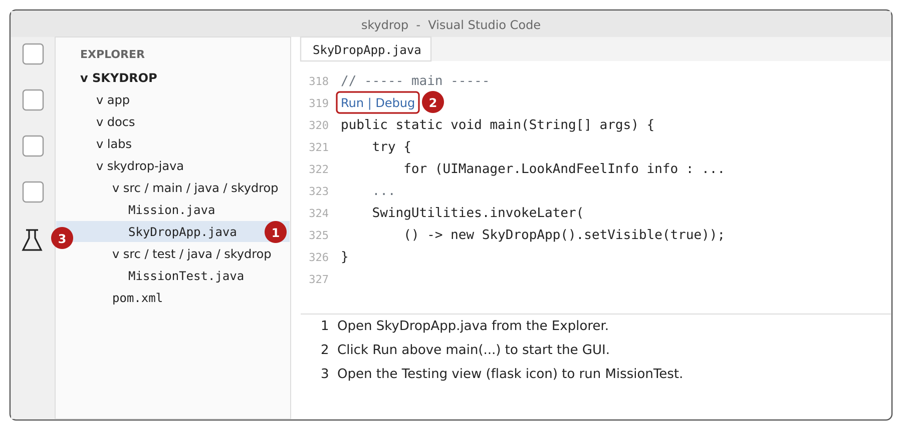

*Figure 2. Schematic of the VS Code window. (1) open the file, (2) run the GUI, (3) open the Testing view.*

The project is laid out like this:

```
skydrop-java/
  pom.xml                                   Project file (Java 17, JUnit 5)
  src/main/java/skydrop/
    Cell.java          A map cell (x, y)
    Order.java         An order in the queue
    Decision.java      ACCEPTED or the reason an order was rejected
    Mission.java       ALL flight rules (no GUI code here)
    MapPanel.java      Draws the map
    SkyDropApp.java    The window and main()
  src/test/java/skydrop/
    MissionTest.java   Unit tests for Mission
```

---

## Part 2: Run the application and test it by hand (7 min)

Open `skydrop-java/src/main/java/skydrop/SkyDropApp.java` and click **Run** above `public static void main`. The window below opens.

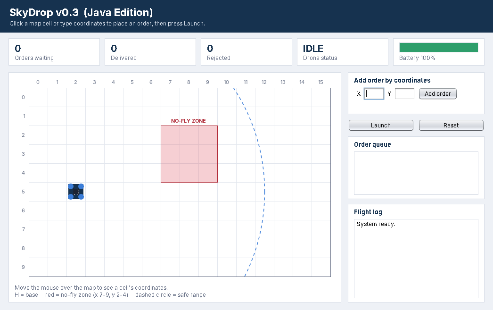

*Figure 3. SkyDrop Java Edition at start-up. The drone sits on the base H at (2, 5).*

Things to check:

- **Hover** over the map. The line under the map shows the cell coordinates and the battery needed for the round trip.
- **Click** a cell to place an order. The result appears in green (accepted) or red (rejected) under the coordinate boxes, and in the flight log.
- **Type** X and Y and press **Add order** (or Enter).
- Press **Launch** to fly the queue. Press **Reset** to start again.

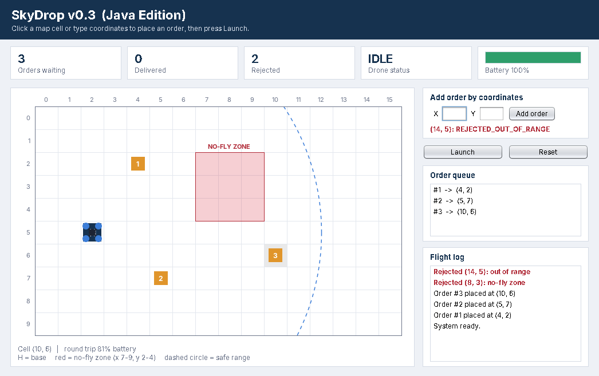

*Figure 4. Three accepted orders, one rejected for the no-fly zone (8, 3) and one rejected for range (14, 5).*

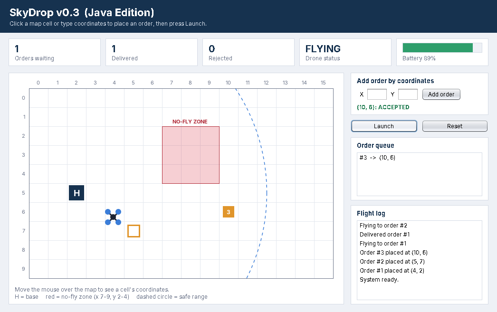

*Figure 5. After Launch the status changes to FLYING and the battery goes down by 5% per cell.*

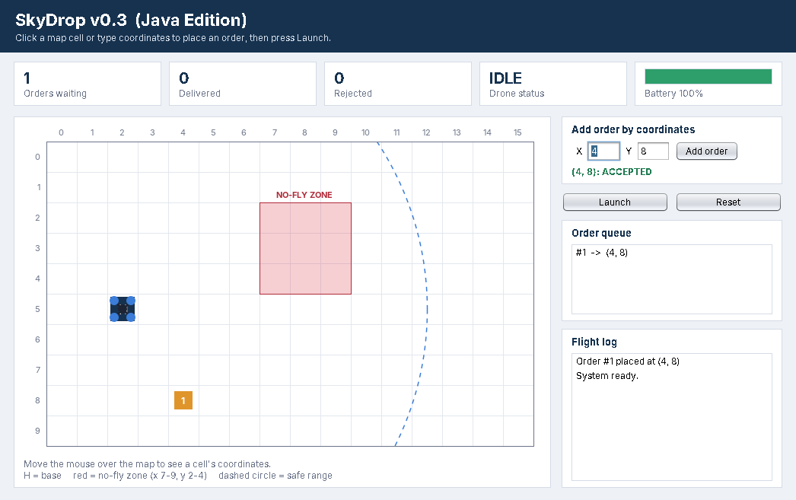

*Figure 6. Placing an order by typing X = 4 and Y = 8.*

### The rules you are testing

| ID | Rule |
|---|---|
| FR-2 | Orders are delivered first come, first served. |
| FR-3 | Any order inside the no-fly zone (x 7 to 9, y 2 to 4), edges included, is rejected. |
| FR-4 | An order is accepted only if the round trip costs 100% battery or less. The drone uses 5% per cell, so round trip = 2 x distance x 5. |
| FR-7 (new) | An order outside the 16 x 10 map (x 0 to 15, y 0 to 9) is rejected. |

### Manual test table

Press **Reset** before each row unless the row says otherwise. Fill in the last two columns.

| # | Rule | How | Input (x, y) | Why this input | Expected result | Actual result | Pass? |
|---|---|---|---|---|---|---|---|
| M1 | FR-1 | Click | (4, 2) | Normal cell | ACCEPTED, order #1 on the map |  |  |
| M2 | FR-3 | Click | (8, 3) | Centre of the zone | REJECTED_NO_FLY_ZONE |  |  |
| M3 | FR-3 | Click | (7, 2) | Top-left corner of the zone (edge) | REJECTED_NO_FLY_ZONE |  |  |
| M4 | FR-3 | Click | (6, 3) | One cell left of the zone | ACCEPTED |  |  |
| M5 | FR-4 | Click | (12, 5) | Exactly 100% round trip (boundary) | ACCEPTED |  |  |
| M6 | FR-4 | Click | (13, 5) | 110% round trip, just beyond | REJECTED_OUT_OF_RANGE |  |  |
| M7 | FR-1 | Type | (4, 8) | Typed normal cell | ACCEPTED |  |  |
| M8 | FR-7 | Type | (2, 10) | One row below the map | REJECTED_OFF_MAP |  |  |
| M9 | FR-7 | Type | (-3, 5) | Negative x, left of the map | REJECTED_OFF_MAP |  |  |
| M10 | Input | Type | (abc, 5) | Not a number | Message: X and Y must be whole numbers |  |  |
| M11 | FR-2 | Click (4, 2), (5, 7), (10, 6), then Launch | - | Three orders | Log shows delivery #1, then #2, then #3 |  |  |

You should find that two rows fail. Here is what M8 looks like:


*Figure 7. Bug: (2, 10) is ACCEPTED. The queue shows the order but nothing is drawn, because row 10 does not exist.*


*Figure 8. After Launch the drone flies off the bottom edge (only two rotors are visible) and the log reports "Delivered order #1".*

### Known major bugs in version 0.3

Testing by hand found these problems. In this lab we fix **B1** only.

| ID | Bug | How to reproduce | Severity | Planned fix |
|---|---|---|---|---|
| **B1** | Orders outside the map are accepted. | Type (2, 10) or (-3, 5). | High: the drone leaves the mapped, approved area. | **This lab (FR-7)** |
| B2 | The drone flies straight through the no-fly zone. | Click (11, 3), then Launch. | Critical: breaks airspace rules even though the order itself is legal. | Path planning (Week 12) |
| B3 | No battery reserve. | Click (12, 5), then Launch. The drone lands with about 1% left. | High: any wind or detour would cause a crash. | Requirement change: keep a 20% reserve |
| B4 | An order on the base is accepted, then silently dropped. | Click (2, 5), then Launch. The log says "All orders delivered" but Delivered stays 0. | Medium: an order is lost without any error. | Reject orders on the base cell |
| B5 | Duplicate orders are accepted silently and a single order cannot be cancelled. | Click the same cell twice. | Low: usability. | GUI change |

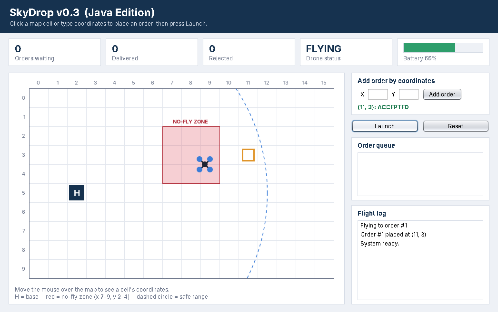

*Figure 9. Bug B2: the order at (11, 3) is legal, but the straight-line flight path passes through the red zone.*

### Can the GUI be better?

Compared with the browser version 0.1, the Java GUI adds axis numbers, a hover read-out of the cell and its battery cost, typed coordinates, and a coloured result message for every order. Further improvements worth discussing:

- draw the planned flight path before Launch, so B2 is visible before the drone takes off;
- disable **Launch** while the drone is flying or the queue is empty;
- let the user cancel one order (right-click) instead of resetting everything;
- add a speed control, because a full delivery takes under two seconds; and
- do not rely on colour alone: the result text already names the reason, and the map could label rejected cells.

---

## Part 3: Why unit tests? (4 min)

Part 2 took several minutes and you had to read the screen carefully. If a teammate changes `Mission.java` tomorrow, someone must repeat every row. That does not scale.

A **unit test** is a small piece of code that calls **one unit** (here, one method of `Mission`) with a fixed input and checks the result against the expected output automatically.

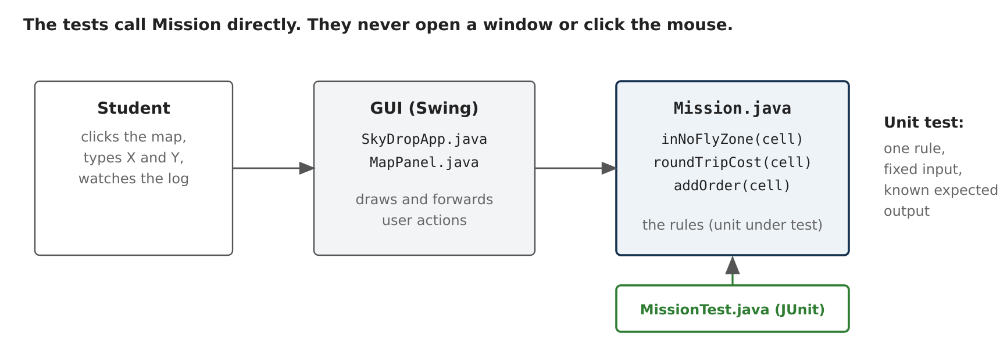

*Figure 10. The rules live in `Mission.java`, separate from the GUI. That separation is what makes them easy to test.*

| | Manual testing (Part 2) | Unit testing (Part 4) |
|---|---|---|
| Speed | Minutes per run | Milliseconds per run |
| Repeatable | Depends on the person | Identical every time |
| When it runs | When someone remembers | Every build, every push (CI, Week 10) |
| When it fails | "Something looks wrong" | Names the exact test, expected value and actual value |
| Value later | Lost after the lab | Stays in the repo as a safety net against regressions |

Unit tests do not replace all other testing. They cannot tell you whether the map is easy to read or whether the drone's path looks right. That is why the GUI was still explored by hand first.

### Anatomy of a JUnit 5 test

Every test follows **Arrange, Act, Assert**:

```java
@Test                                                        // marks a test method
@DisplayName("TC1  FR-3  centre of the no-fly zone (8, 3) is restricted")
void centreOfNoFlyZoneIsRestricted() {
    // Arrange: build the input
    Cell centre = new Cell(8, 3);

    // Act: call the ONE method under test
    boolean restricted = mission.inNoFlyZone(centre);

    // Assert: compare actual with expected
    assertTrue(restricted, "(8, 3) is in the middle of the red zone");
}
```

`@BeforeEach` creates a new `Mission` before every test, so one test can never affect another. The assertions you need today are `assertTrue`, `assertFalse` and `assertEquals(expected, actual)`.

---

## Part 4: Run the three provided test cases (4 min)

Open `skydrop-java/src/test/java/skydrop/MissionTest.java`. Then do **one** of these:

- click the **Testing** (flask) icon on the left and press the run button next to `MissionTest`; or
- click the green triangle in the editor margin next to `class MissionTest`.

| Test | Rule | Method called | Input | Expected | Technique |
|---|---|---|---|---|---|
| TC1 | FR-3 | `inNoFlyZone` | (8, 3) | `true` | Typical value inside the zone |
| TC2 | FR-3 | `inNoFlyZone` | (6, 3) | `false` | Boundary: one cell outside the edge |
| TC3 | FR-4 | `addOrder` | (13, 5) | `REJECTED_OUT_OF_RANGE`, queue size 0, rejected count 1 | Boundary: just beyond 100% |

All three should show a green tick. Try breaking one on purpose: change the expected value in TC2 to `assertTrue`, run again, read the red failure message, then change it back.

---

## Part 5: Your turn, write TC4 (5 min)

The bottom-right corner of the no-fly zone is **(9, 4)**. Corners are where off-by-one mistakes hide (Lab 1 had one).

In `MissionTest.java`, find the commented-out **TC4**, remove the `//` marks, and fill in the blanks:

```java
@Test
@DisplayName("TC4  FR-3  corner of the zone (9, 4) is rejected")
void cornerOfNoFlyZoneIsRejected() {
    Cell corner = new Cell(__, __);

    Decision decision = mission.addOrder(corner);

    assertEquals(__________, decision);
    assertEquals(__, mission.getQueue().size());
}
```

Run the tests. You should now have four green ticks. If TC4 is red, read the message: is the mistake in your test or in the code?

---

## Part 6: New feature FR-7, test first (7 min)

**FR-7:** An order outside the 16 x 10 map must be rejected with `Decision.REJECTED_OFF_MAP`, must not enter the queue, and must add 1 to the rejected count.

The value `REJECTED_OFF_MAP` already exists in `Decision.java`, but `addOrder()` never returns it. That is bug B1.

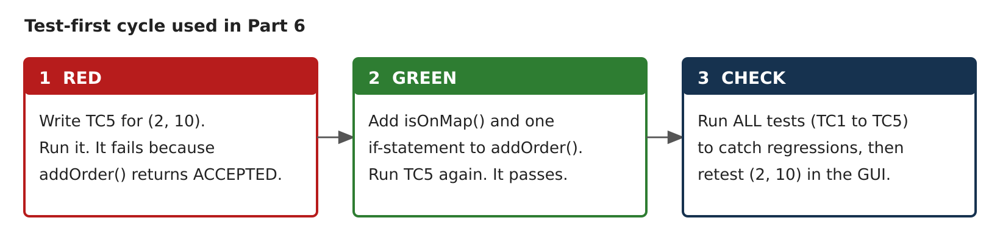

### Step 1, RED: write the test before the fix

Uncomment **TC5** in `MissionTest.java` and write the body yourself. Use row M8 from your table: input (2, 10), expected `REJECTED_OFF_MAP`, and the queue should stay empty. Run it. **It must fail.** A test that has never failed has not proved anything.

### Step 2, GREEN: write the smallest code that passes

In `Mission.java`:

1. Add a method `public boolean isOnMap(Cell c)` that returns `true` only when x is between 0 and `COLS - 1` and y is between 0 and `ROWS - 1`.
2. At the **start** of `addOrder()`, if the cell is not on the map, add 1 to `rejected`, write a red log line `"Rejected (x, y): off the map"`, and return `Decision.REJECTED_OFF_MAP`.

Use the existing no-fly zone check in `addOrder()` as a pattern. Run TC5 again until it passes.

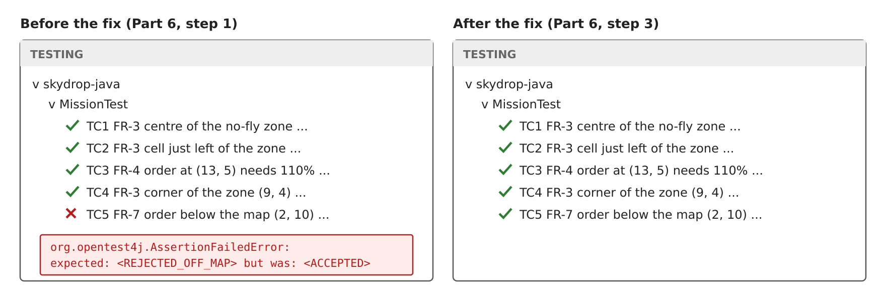

*Figure 11. Expected Testing view before and after the fix.*

### Step 3, CHECK: regression and retest

1. Run **all** tests. TC1 to TC5 must all be green. If an older test turned red, your change broke something else (a regression).
2. Run the GUI again and type (2, 10). It should now be rejected:

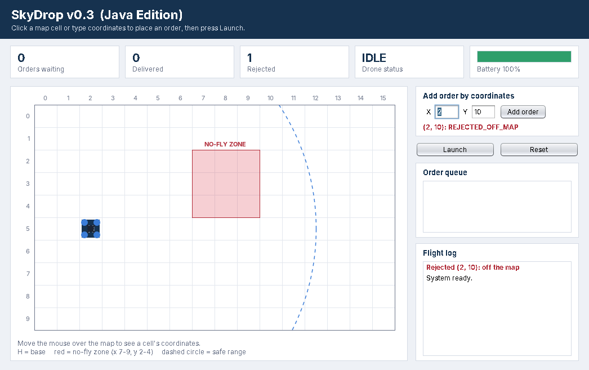

*Figure 12. After the fix, (2, 10) is rejected and the drone stays at base.*

3. Update the **Actual** and **Pass?** columns for M8 and M9.

---

## If you finish early

Each of these is one more test in `MissionTest.java`:

1. **Boundary values for `isOnMap`.** Test (0, 0), (15, 9), (16, 9) and (0, -1). Which are on the map?
2. **FR-4 boundary.** (12, 5) costs exactly 100%. Assert that `addOrder` returns `ACCEPTED`. Then use `assertEquals(100.0, mission.roundTripCost(new Cell(12, 5)), 0.001)`. Why does a `double` comparison need the third argument?
3. **FR-2.** Add (4, 2) then (5, 7) and assert that `getQueue().get(0).id()` is 1.
4. **B4.** Write a test showing that an order on the base (2, 5) should be rejected. It will fail. Is this a bug or a missing requirement?

## Submission

Commit your changes on a branch and open a pull request, as described in [`CONTRIBUTING.md`](../../CONTRIBUTING.md):

```powershell
git checkout -b feature/fr7-off-map-validation
git add skydrop-java
git commit -m "FR-7: reject orders outside the map, with tests TC4 and TC5"
git push -u origin feature/fr7-off-map-validation
```

Your pull request description should include the completed manual test table and a screenshot of the Testing view with all tests passing.

## Troubleshooting

| Problem | Fix |
|---|---|
| No **Run** link above `main` | Wait for **Java: Ready** in the status bar. Check that the Extension Pack for Java is installed. |
| `junit` cannot be resolved | VS Code is still downloading dependencies, or the computer is offline. Run **Java: Clean Java Language Server Workspace** from the Command Palette (Ctrl+Shift+P). |
| Wrong Java version | Install JDK 17 or newer (for example Eclipse Temurin) and run **Java: Configure Java Runtime**. |
| Testing view is empty | Open `MissionTest.java` once, then press the refresh button in the Testing view. |
| Prefer the terminal | If Maven is installed: `cd skydrop-java`, then `mvn test` to run tests, or `mvn compile exec:java` to start the GUI. |

## Discussion

1. Which rows of the manual table could become unit tests? Which could not, and why?
2. TC5 was written before the fix. What would you lose if you wrote it after?
3. Bug B2 (flying through the zone) is not caught by any test. What would a test for it need to check?
4. Why is it important that `Mission.java` contains no Swing code?
